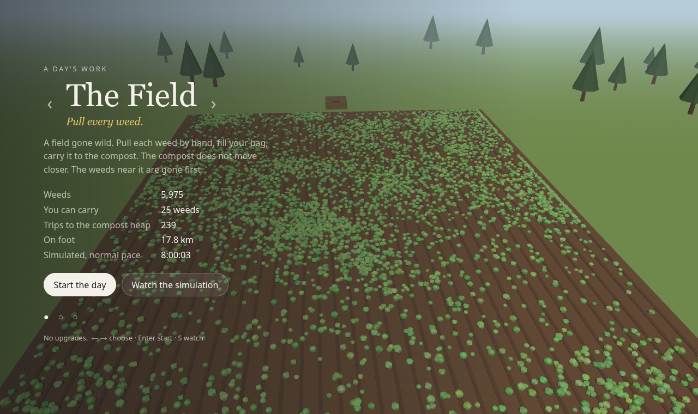
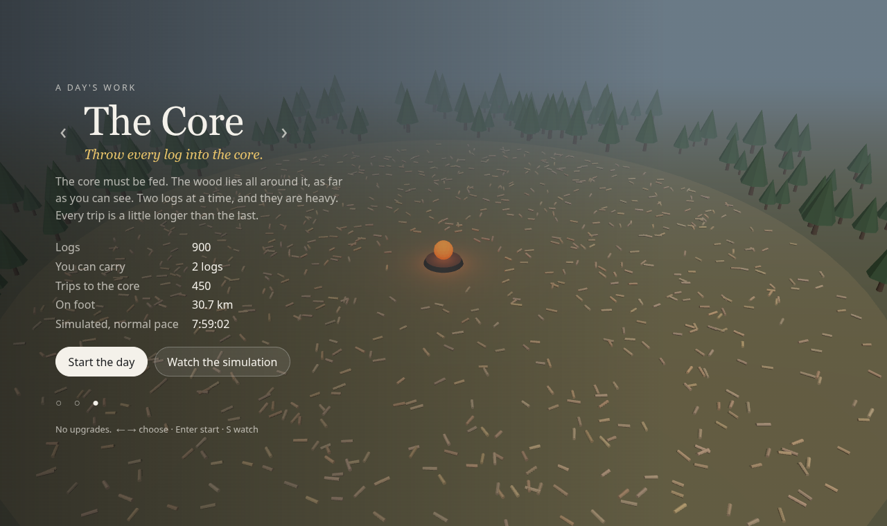
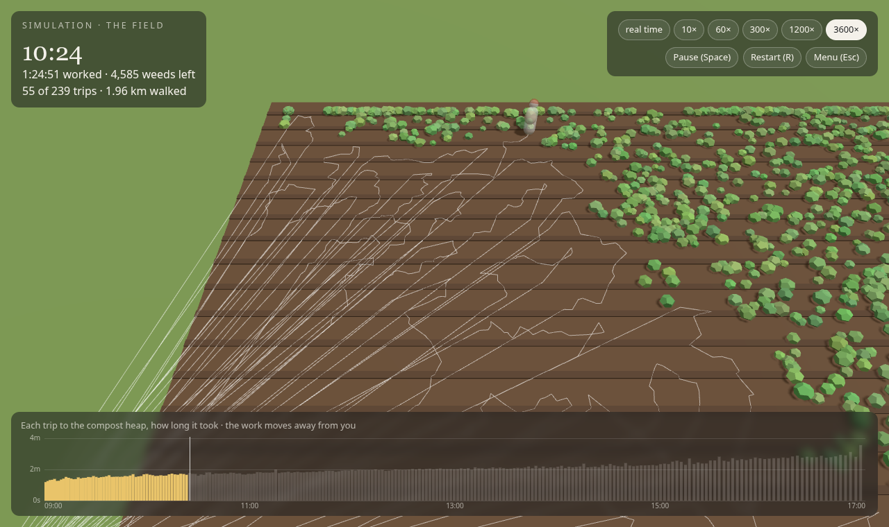
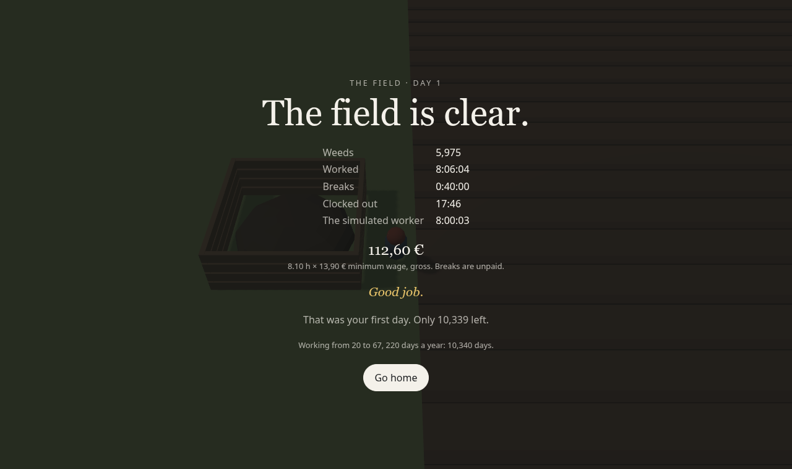

# A Day's Work

**An idle game with the upgrades taken out.**

Idle games start with a big task and make it faster and faster: better tools, more
workers, automation. *A Day's Work* never does. You pull every weed, sort every thing
on the floor and carry every log yourself, one at a time.

Each job is sized by a simulator so that an ordinary person at a normal pace needs
**exactly 8 hours of work**. Breaks come on top of that. At the end you get paid
minimum wage and are told how many working days you have left.

It's an art piece.



## The jobs

Use ← → in the menu to choose.

| | Job | You carry | Items | Trips | On foot |
|---|---|---|---|---|---|
| 🌱 | **The Field**: pull every weed, take the bag to the compost | 25 weeds | 5,975 | 239 | 17.8 km |
| 📦 | **The Floor**: sort everything into the bin of its colour | 1 thing | 1,040 | 1,040 | 37.1 km |
| 🔥 | **The Core**: throw every log into the core | 2 logs (heavy) | 900 | 450 | 30.7 km |



## The simulator

`src/sim.js` simulates an ordinary person who works sensibly but isn't a robot:

- Until their hands are full, they walk to the **nearest remaining item**. For the last item
  before they're full, they pick the one that also lies towards the depot.
- When full, they **walk back and unload**.
- Walking speed is 1.05–1.4 m/s, slower with heavy logs. Paths are 10% longer than a straight
  line, and each item costs extra time for bending down and lining up.
- The pick and unload durations are the same ones you have to hold in the game.

As the day goes on, the work moves away from you: the nearby items are gone first, so trips
get longer. **Watch the simulation** in the menu to see the whole day at up to 3600× speed,
with the worker's path and a chart of every trip.



`npm run calibrate` searches for the item count that makes each job take 8:00:00 and
writes `src/calibration.js`. If you change any assumption in `src/jobs.js`, re-run it.
CI fails if the calibration is out of date.

## The end of the day



You're paid for the hours you actually worked at the German statutory minimum wage
(2026: €13.90/h); breaks are unpaid. The days left assume working from age 20 to 67
at 220 days a year, which is 10,340 days. All of these are constants at the top of
`src/main.js`.

## Playing

| | |
|---|---|
| Walk | WASD / arrow keys, or click on the ground |
| Work | hold Space or E (touch: hold the on-screen button) |
| Break | B. The wall clock keeps going; the work timer doesn't |
| Menu | Esc. Progress is saved in your browser |

Nobody plays 8 hours in one go. Come back to it during the day.

## Running locally

The game is static: no bundler and no dependencies. three.js is vendored in `vendor/`.

```sh
npm start              # serves on 0.0.0.0:8080 -> http://localhost:8080 or http://<your-ip>:8080
npm run calibrate      # re-size the jobs to 8 hours
npm run check          # verify the calibration is current
npm run build          # copy the site to _site/
```

Requires Node 24+ for the tools only.

## Deploying

`.github/workflows/pages.yml` checks the calibration, builds the site and deploys it to
GitHub Pages on every push to `main`. Pull requests are only built.
Enable it once under **Settings → Pages → Source: GitHub Actions**.

## Adding a job

1. Add an entry to `JOBS` in `src/jobs.js`: its parameters and a `generate(n, rng)` layout.
2. Give it a look in `buildWorld` in `src/world.js`.
3. `npm run calibrate`.

## Credits

Built with [three.js](https://threejs.org) (MIT, see `vendor/three.LICENSE`).
